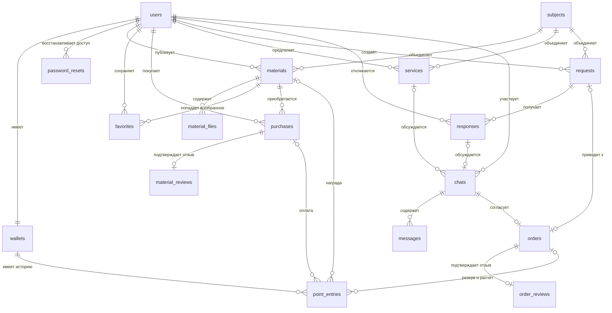

# Архивное предложение базы «УниМаркет»: 17 таблиц

Этот вариант сохранён для истории обсуждения. Пользователь ограничил будущую учебную БД максимум 10 таблицами; перечисленные ниже 17 таблиц и их ограничения больше не являются текущим направлением разработки. Актуальное предложение — [компактная концептуальная модель](DATABASE_CONCEPT.md) и [редактируемая схема draw.io](diagrams/unimarket-concept.drawio). Логическая модель и DDL ещё не разрабатываются.

Предложение от 29 октября 2026. Это модель данных и основных связей с предварительными полями, а не выполненный SQL-скрипт. Основание — README, карта проекта и существующие формы. Полный актуальный макет повторно не прочитан из-за тайм-аутов Figwright.

Для независимой консультации подготовлен самостоятельный [DATABASE_REVIEW.md](DATABASE_REVIEW.md): контекст, требования, частые выборки, кандидаты индексов, примеры DML и открытые вопросы. Это снимок предложения для проверки другим агентом; основная модель описана здесь.

Полученная консультация проверена в [DATABASE_FEEDBACK.md](DATABASE_FEEDBACK.md). После неё пользователь уточнил правила награды, бесплатных материалов и отмены в [SPECIFICATION.md](SPECIFICATION.md). Перед DDL нужно привести модель заказов к этим правилам; её текущие поля и диаграмма остаются предложением. PHP-примеры консультации содержат пропуски проверок.

Уточнение R7: после допустимой отмены с возвратом баллов заявка открывается повторно, можно выбрать другого или того же исполнителя, старый заказ сохраняется. Поэтому первоначальные UNIQUE(orders.request_id), а также сочетание UNIQUE(orders.chat_id) и UNIQUE(chats.response_id), описанные ниже, нельзя переносить в DDL без пересмотра на этапе 2. Требуется сохранить не более одного действующего заказа по заявке, разрешив историю отменённых заказов и повторное назначение.

## Как используется база

Браузер отправляет запрос PHP → PHP проверяет пользователя и данные → обращается к MariaDB → возвращает результат браузеру. DBeaver — отдельное приложение разработчика для просмотра данных, таблиц, запросов и связей. Приложение сайта работает без запущенного DBeaver; сервер MariaDB должен работать.

Рекомендация: MariaDB Server и DBeaver Community на Windows. Если команда уже выбрала MySQL, использовать тот же сервер, чтобы не поддерживать два окружения. SQL создания таблиц будем хранить в репозитории, когда перейдём к реализации. Сам сервер, его данные и пароли в Git не помещаем.

## Основные решения

- Один пользователь может покупать, публиковать материалы, предлагать услуги и создавать заявки. Отдельные таблицы покупателей и авторов не нужны.
- Все расчёты — целые баллы. Корзины нет. Покупка материала и заказ услуги — разные сущности.
- Один материал относится к одному предмету; имеет один тип и один целевой курс. Несколько предметов или курсов на материал пока не требуются.
- В избранное пока добавляются материалы, как описано в карте проекта.
- Переписка ведётся между двумя участниками, без групповых чатов. Один чат — одно обсуждение услуги или конкретного отклика; в нём может появиться один заказ. Для повторного заказа создаётся новое обсуждение.
- По заявке выбирается один исполнитель. Один исполнитель оставляет один отклик на заявку и может редактировать его до выбора.
- Покупатель может оставить один отзыв о приобретённом материале и заказчик — один отзыв об исполненном заказе. Взаимные отзывы и повторные покупки одного материала пока не закладываем.
- Это предлагаемые правила. Изменение любого из них может изменить ограничения таблиц.

## Таблицы и предварительные поля

`id` — идентификатор записи. Поле с окончанием `_id` ссылается на запись другой таблицы; исключения явно описаны. Даты создания нужны всем сущностям, где важна история. Конкретные SQL-типы и индексы определим следующим шагом.

### Аккаунты

| Таблица | Содержимое и основные поля |
|---|---|
| `users` | `id`, `email`, `password_hash`, `first_name`, `last_name`, `course`, `bio`, `avatar_path`, `role`, `status`, `created_at`. Пароль хранится только как хеш; повтор пароля не хранится. `email` уникален. Подтверждены две роли: пользователь и администратор; отдельного модератора нет. Покупатель и автор не являются отдельными ролями |
| `wallets` | `user_id` одновременно первичный ключ и ссылка на `users`; `available_points`, `reserved_points`. Ровно один кошелёк создаётся вместе с пользователем в одной транзакции; оба остатка при регистрации равны 0, приветственного бонуса нет. Первичный ключ запрещает второй кошелёк, а обязательное создание первого обеспечивает сценарий регистрации |
| `password_resets` | `id`, `user_id`, `token_hash`, `expires_at`, `used_at`, `created_at`. Хеш одноразового секрета восстановления; для короткого кода дополнительно нужны учёт попыток и ограничение частоты запросов |

### Материалы

| Таблица | Содержимое и основные поля |
|---|---|
| `subjects` | `id`, `name`; уникальные названия предметов, например «Математика» |
| `materials` | `id`, `author_id`, `subject_id`, `title`, `description`, `type`, `course`, `price_points`, `status`, `moderator_id`, `moderated_at`, `rejection_reason`, `created_at`. `author_id` и `moderator_id` ссылаются на `users`; модератор может отсутствовать до решения. Состояния: черновик, проверка, опубликован, отклонён, архив |
| `material_files` | `id`, `material_id`, `storage_key`, `original_name`, `mime_type`, `size_bytes`. Один материал содержит несколько файлов; ключ хранения не является публичной ссылкой. Предлагаемая первая версия после покупки открывает весь набор; опубликованные купленные файлы не заменяются незаметно |
| `favorites` | `user_id`, `material_id`, `created_at`. Пара идентификаторов — составной первичный ключ: одно и то же избранное нельзя добавить дважды |
| `purchases` | `id`, `buyer_id`, `material_id`, `paid_points`, `created_at`. Пара `(buyer_id, material_id)` уникальна. Запись означает завершённую покупку; цена сохраняется на момент покупки |
| `material_reviews` | `purchase_id` — первичный ключ и ссылка на `purchases`; `rating`, `text`, `created_at`. Покупатель и материал определяются через покупку, повторять их идентификаторы не нужно. Оценка от 1 до 5 |

### Услуги, заявки и общение

| Таблица | Содержимое и основные поля |
|---|---|
| `services` | `id`, `provider_id`, `subject_id`, `title`, `description`, `format`, `duration_minutes`, `price_points`, `status`, `created_at`. Исполнитель — `users`, предмет — `subjects`. Услуга оплачивается по цене объявления, которая сохраняется в заказе на момент оплаты. Изменение объявления не меняет уже оплаченную стоимость; отдельный торг и индивидуальные скидки пока не закладываются |
| `requests` | `id`, `customer_id`, `subject_id`, `title`, `description`, `budget_points`, `deadline`, `status`, `created_at`. Заказчик — `users`; состояния: открыта, исполнитель выбран, завершена, отменена |
| `responses` | `id`, `request_id`, `provider_id`, `text`, `proposed_points`, `proposed_deadline`, `created_at`. Пара `(request_id, provider_id)` уникальна. Выбранный отклик определяется через заказ, отдельный дублирующий флаг не нужен |
| `chats` | `id`, `customer_id`, `provider_id`, `service_id`, `response_id`, `created_at`. Ровно одна из ссылок `service_id` и `response_id` заполнена: обсуждается услуга или отклик. Для отклика допускается один чат: `response_id` уникален. Для услуги можно создать новое обсуждение повторного заказа |
| `messages` | `id`, `chat_id`, `sender_id`, `text`, `created_at`, `read_at`. Отправитель — один из двух участников чата. Для первой версии сообщения текстовые |
| `orders` | `id`, `chat_id`, `request_id`, `description`, `agreed_points`, `deadline`, `status`, `result_storage_key`, `created_at`, `completed_at`. `chat_id` уникален: в обсуждении не более одного заказа. Для заказа по заявке `request_id` заполнен и уникален: одна заявка не даёт два заказа разным исполнителям. Для услуги он пуст. Ссылка на заявку должна совпадать с заявкой отклика чата; участники заказа берутся из чата и после создания заказа не меняются |
| `order_reviews` | `order_id` — первичный ключ и ссылка на `orders`; `rating`, `text`, `created_at`. Один отзыв заказчика об исполнителе после завершения; оба участника определяются через заказ и чат |

### Баллы

| Таблица | Содержимое и основные поля |
|---|---|
| `point_entries` | `id`, `wallet_id`, `operation_key`, `available_delta`, `reserved_delta`, `reason`, `material_id`, `purchase_id`, `order_id`, `created_at`. `wallet_id` ссылается на `wallets.user_id`. Изменения доступных и зарезервированных баллов — целые числа со знаком. Для текущих причин заполнена ровно одна ссылка на источник: материал, покупку или заказ. Пара `(operation_key, wallet_id)` уникальна; ключ события формирует PHP из причины и источника, чтобы повторный запрос не создал повторное начисление |

Всего 17 таблиц для полного заявленного объёма. Это целевая модель; создавать все таблицы одновременно не требуется.

## Связи

Схема показывает основные связи. Повторные ссылки на `users` (модератор, отправитель и второй участник чата) описаны в таблицах выше, чтобы диаграмма оставалась читаемой. `||` означает ровно одну запись, `o|` — ноль или одну, `o{` — ноль или много.



Примеры трёх требуемых типов:

- **1:1:** пользователь и кошелёк. Дополнительный пример 1:0..1 — покупка и отзыв.
- **1:N:** пользователь и его материалы. `materials.author_id` указывает на автора.
- **M:N:** пользователи и материалы через `favorites`; также через `purchases`. У пользователя много материалов, у материала много пользователей. В SQL это две связи 1:N через промежуточную таблицу.

Все сущности входят в одну связанную модель. При этом каждая таблица не обязана напрямую ссылаться на каждую другую.

## Правила целостности

1. Внешние ключи связывают существующие записи, `UNIQUE` запрещает повторные пары и вторые кошельки. Использовать InnoDB и utf8mb4. Email нормализуется перед сохранением по единому правилу приложения.
2. Доступные и зарезервированные баллы, цены и бюджеты неотрицательны. Оценка — от 1 до 5. Хотя бы одно из двух изменений в записи истории ненулевое. Проверки диапазонов выполняются в базе и PHP.
3. В истории кошелька записывается каждое изменение; текущие суммы в `wallets` обновляются с историей в одной транзакции. При старте с нуля суммы изменений должны совпадать с текущими остатками.
4. Для заказа на 100 баллов резерв даёт заказчику изменения `-100 / +100`. Принятие результата даёт заказчику `0 / -100`, исполнителю `+100 / 0`. Отмена с возвратом резерва даёт заказчику `+100 / -100`. Каждое событие имеет стабильный ключ; награда за материал также привязана к его ID и выдаётся однократно.
5. Покупка, история баллов и изменение обоих кошельков выполняются в одной транзакции с блокировкой строк кошельков. Списание нельзя проверять только в JS. Повторная покупка отсекается уникальной парой покупатель/материал. Покупка своего материала запрещена.
6. Пользователь подтвердил: полная цена покупки переводится автору без комиссии; дополнительно за каждый впервые одобренный материал выдаётся 100 баллов один раз, независимо от продаж. Бесплатные материалы разрешены: рекомендуется сохранять покупку и доступ без нулевых записей point_entries. Покупка материала сразу открывает файл и не отменяется. Услугу сначала согласуют в чате, затем оформляют и оплачивают с резервом баллов; час на отмену начинается после успешной оплаты. Срок оплаты согласуют в чате. После принятия результата отмена недоступна. Полные правила — в SPECIFICATION.md.
7. История покупок, баллов и заказов не удаляется каскадно вместе с аккаунтом или публикацией: использовать архивирование/блокировку. Избранное и секреты восстановления можно удалять. Физическое удаление финансовых источников ограничивать внешними ключами.
8. Файлы хранятся вне публичного каталога; база содержит метаданные. PHP проверяет право автора, покупателя или модератора перед выдачей. Поиск и каталог видят только опубликованные материалы с доступными файлами.
9. PHP в транзакции проверяет соответствие участников и источника чата/заказа, выбор одного исполнителя, допустимые переходы состояний, завершение заказа перед отзывом и авторство сообщений. Одни внешние ключи этих правил не обеспечивают. `UNIQUE(request_id)` у заказа дополнительно защищает от двух одновременно выбранных исполнителей.
10. Рейтинг автора и количество покупок вычисляются из данных. Таблиц для рейтинга, каждой страницы, курсов 1–6, ролей и каждого статуса в первой версии не создаём. Отдельная история модерации понадобится только при требовании хранить все повторные решения; сейчас сохраняется последнее.

## Порядок создания и проверки

1. Аккаунт: `users`, `wallets`. Проверка — новый пользователь и один кошелёк; повторный email и второй кошелёк отклоняются.
2. Восстановление: `password_resets`; проверяются срок действия, однократность и ограничение попыток.
3. Каталог: `subjects`, `materials`, `material_files`, `favorites`. Проверка — материал несуществующего автора отклоняется, повторное избранное запрещено. Для знакомства с базой достаточно тестового материала.
4. Баллы и покупка: `purchases`, `point_entries`, затем `material_reviews`. Проверяются повторный запрос, недостаток баллов, согласованность остатков и истории, доступ к файлу и отсутствие отзыва без покупки.
5. Услуги и заявки: остальные таблицы; проверить выбор одного исполнителя, закрытые чаты, резерв, подтверждение и возврат баллов.

Именно первые две таблицы — ближайший небольшой шаг реализации. До подключения PHP связи и ограничения можно проверить вручную запросами и через редактор данных DBeaver; серверные сценарии тестируются после появления PHP.

## Приложение и создание базы

- [DBeaver Community](https://dbeaver.com/edition/community/) — клиент для разработчика.
- [Установка MariaDB Server на Windows](https://mariadb.com/docs/server/server-management/install-and-upgrade-mariadb/installing-mariadb/binary-packages/installing-mariadb-msi-packages-on-windows) — установка движка хранения данных как службы.
- [Подключение MariaDB в DBeaver](https://dbeaver.com/docs/dbeaver/Database-driver-MariaDB/) — выбрать MariaDB, локальный адрес `localhost`, порт установки (обычно `3306`), имя пользователя и пароль. База `unimarket` выбирается после её создания.
- [Диаграммы DBeaver](https://dbeaver.com/docs/dbeaver/ER-Diagrams/) — просмотр таблиц и внешних ключей на диаграмме.

Порядок: установить сервер и клиент → проверить подключение → создать базу `unimarket` с utf8mb4 → выполнить будущий SQL-скрипт таблиц → открыть диаграмму и внести тестовые данные. Для подключения PHP создать отдельного пользователя базы с правами только на `unimarket`; административный аккаунт нужен для настройки. Установка и создание сервера в этой задаче не выполнялись.

Команда создания пустой базы в SQL-редакторе подключённого DBeaver:

```sql
CREATE DATABASE unimarket
    CHARACTER SET utf8mb4
    COLLATE utf8mb4_unicode_ci;
```

Команда ещё не создаёт таблицы и не подключает сайт. Если база уже существует, повторно создавать её не нужно.
